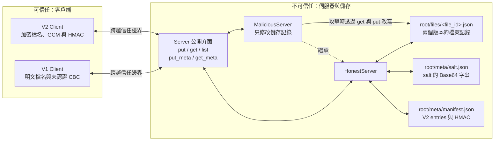
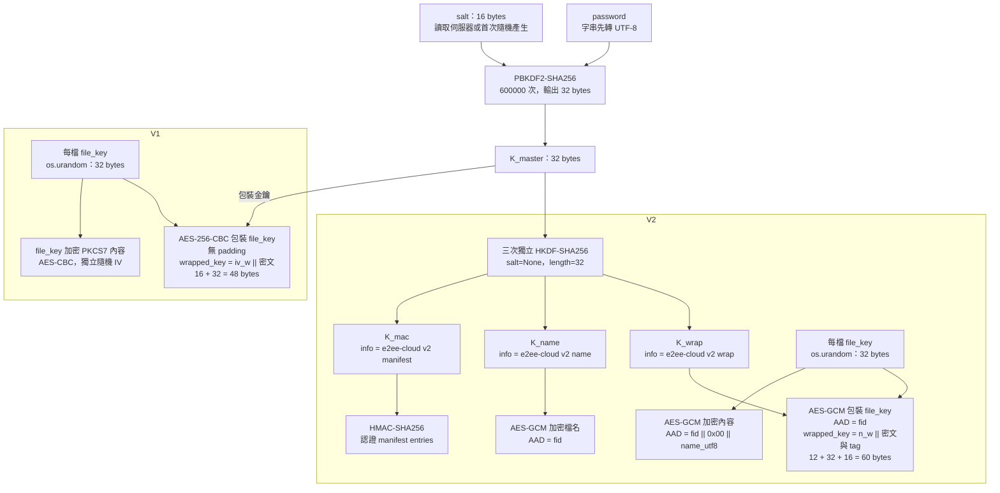
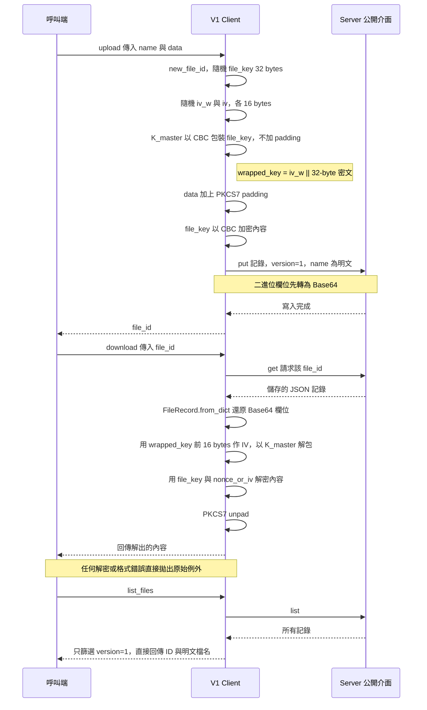
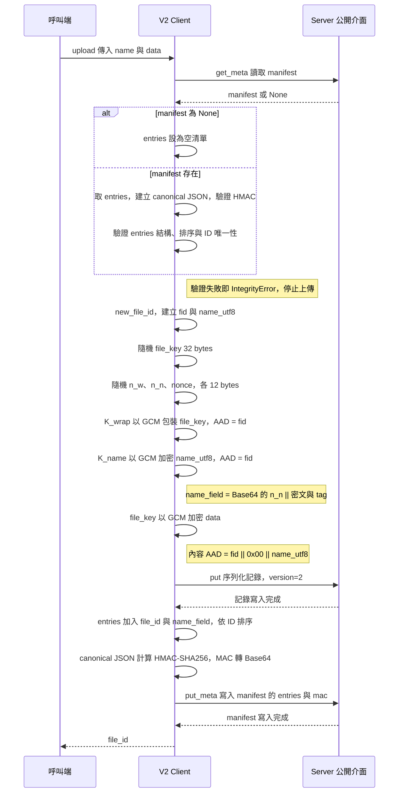
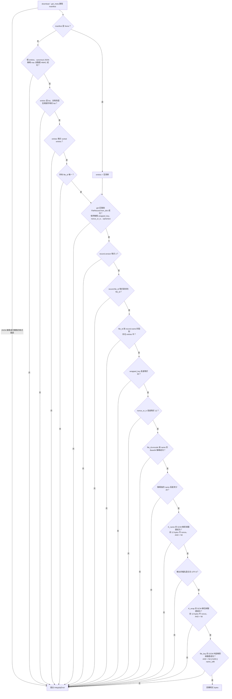
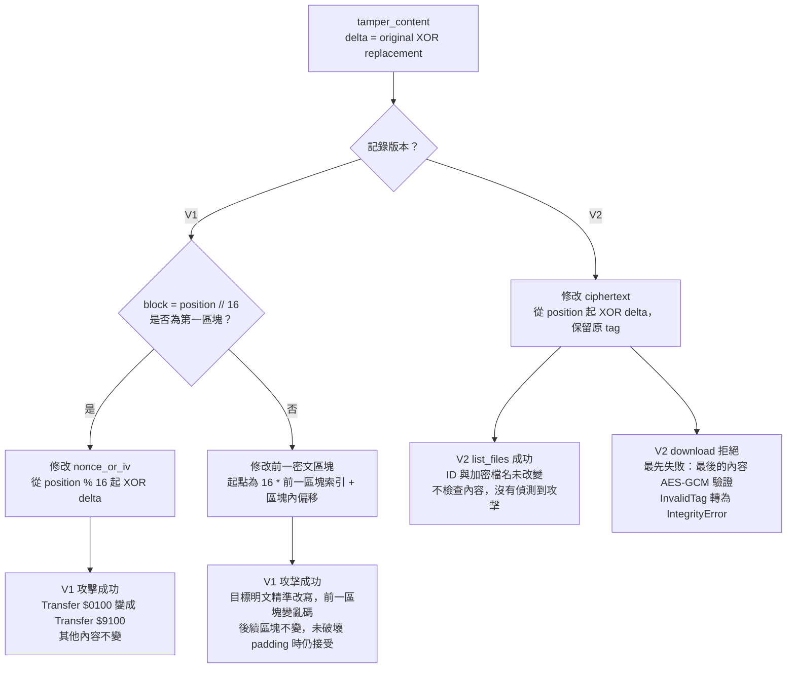
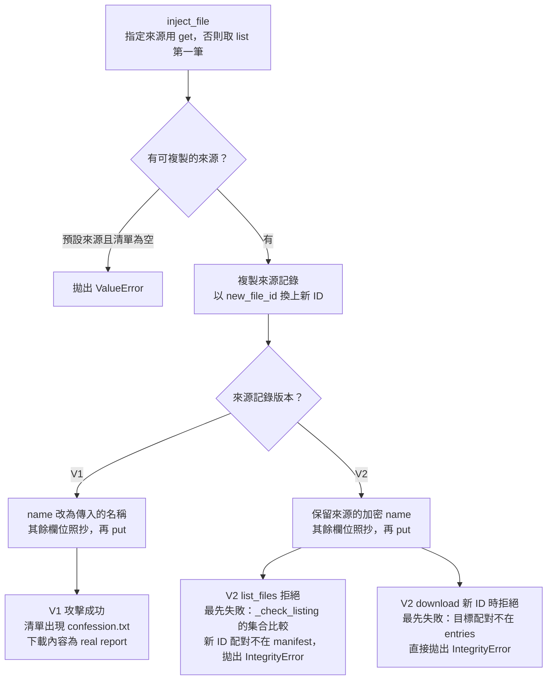
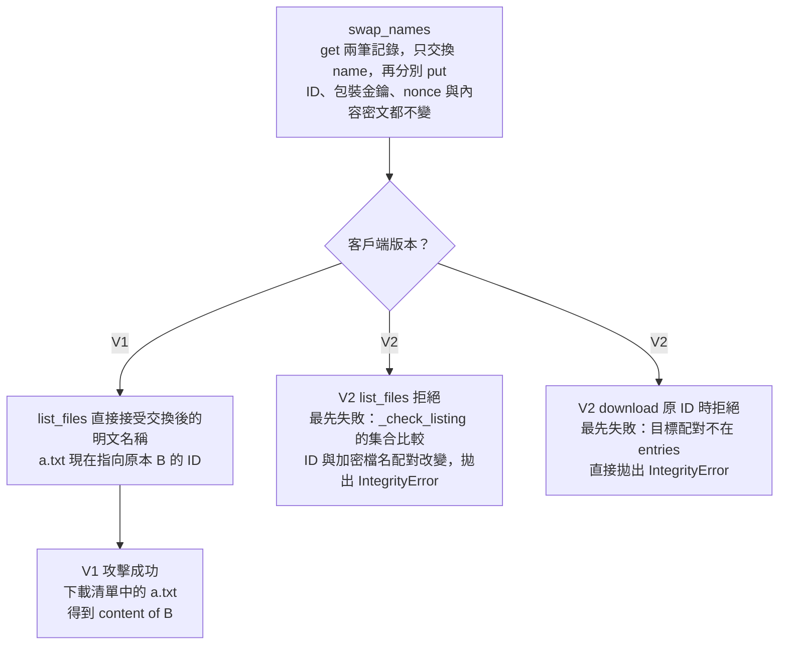

# E2EE 迷你雲端流程圖

以下依據目前的 [V1 客戶端](../v1/client.py)、[V2 客戶端](../v2/client.py) 與 [惡意伺服器](../server/malicious.py) 繪製；金鑰推導及儲存細節另核對 `common/kdf.py`、`common/record.py` 與 `server/storage.py`。

圖中 `fid = file_id.encode()`、`name_utf8 = name.encode("utf-8")`；`||` 表示位元組串接，`0x00` 是一個零位元組。二進位記錄欄位透過 `FileRecord.to_dict()` 轉為 Base64，讀取時由 `FileRecord.from_dict()` 還原。

## 1. 系統架構與信任邊界

這是同一個 Python 程式內的物件呼叫，並非已實作的網路服務。公開介面是呼叫約定，沒有額外的介面類別。`MaliciousServer` 繼承 `HonestServer`，未呼叫攻擊方法時沿用原本行為；密碼、主金鑰與檔案金鑰只在客戶端使用。



`root` 預設是 `storage`。`meta/salt` 與 `meta/manifest` 是介面使用的邏輯鍵，實際檔案都帶 `.json`；manifest 在 V2 上傳後才寫入。伺服器儲存的是包裝金鑰與密文，V1 的 `name` 仍為明文。

## 2. 金鑰階層

兩個建構子先讀取 `get_meta("salt")`；不存在時以 `new_salt()` 產生 16 bytes，存入 Base64 salt。建構子只推導金鑰，不驗證密碼是否正確。每次上傳都另產生一把 32-byte 檔案金鑰，沒有從主金鑰推導檔案金鑰。



V1 的 `iv_w` 與內容 IV 各為 16 bytes。V2 的包裝、檔名、內容 nonce 各自獨立隨機產生，皆為 12 bytes；檔名欄位為 `b64e(n_n || 加密檔名與 tag)`。隨機位元組均來自 `os.urandom`。

## 3. V1 上傳與下載

下圖從建構完成後開始。V1 不驗證清單、版本、記錄 ID、檔名與內容的真實性；解密或 unpad 的例外直接往外傳，不轉為 `IntegrityError`。



## 4. V2 上傳

**實際程式先包裝金鑰，再加密檔名**，下圖依此順序。`upload()` 只呼叫 `_read_manifest()`，沒有呼叫 `_check_listing()`，也不下載或驗證既有檔案內容。記錄先寫入，再寫 manifest，兩次寫入並非交易。



清單認證的位元組格式精確為：

```python
canonical = json.dumps(entries, separators=(",", ":"), sort_keys=True).encode()
```

`entries` 是依 `file_id` 排序的 `[[file_id, name_field], ...]`，其中 `name_field` 是記錄內原樣保存的加密檔名字串。

## 5. V2 下載驗證順序

以下判斷依 `download()`、`_read_manifest()`、`_decrypt_name()` 的實際執行順序排列。`or` 條件從左至右短路，因此版本、ID、清單成員資格，以及兩個長度檢查皆分開標示。`FileRecord.from_dict()` 會先解碼三個二進位欄位，之後才檢查版本與清單成員資格。



`_integrity_checks()` 將 `InvalidTag`、`InvalidSignature`、`ValueError`、`KeyError`、`TypeError`、`AttributeError`、`IndexError` 轉成 `IntegrityError`；Base64、JSON 與 UTF-8 解碼錯誤也包含在這些類型內。程式主動拋出的 `IntegrityError` 直接傳出，並非捕捉所有可能的例外，例如作業系統的 I/O 錯誤不在此轉換清單內。

下載**不呼叫** `_check_listing()`，只檢查目標記錄與 manifest 的配對。相對地，`list_files()` 依序執行 `_read_manifest()`、`_check_listing()`、逐筆 `_decrypt_name()`；清單檢查先比較 version 2 記錄的 `(file_id, name)` 集合，再比較記錄數量，最後才解密檔名。它不解包金鑰，也不驗證內容密文。

## 6. 三種攻擊對照

以下各圖假設原始資料與 manifest 均有效、只單獨執行該項攻擊，且替換內容確實不同、交換的檔名也不同。三種方法都以 `get()` 或 `list()` 取得既有 JSON，再用 `put()` 寫回；**不持有密碼或金鑰，也不修改 manifest**。因此 V2 的 manifest HMAC 本身會先通過，接著才在圖示檢查點失敗。

### 6.1 竄改內容

`tamper_content()` 先確認位置非負、原文與替換文字等長。V1 還要求變更不跨越 16-byte 區塊；V2 的可修改範圍不包含最後 16-byte tag。無效參數會拋出 `ValueError`，不會寫回記錄。



V1 的 `list_files()` 不受密文修改影響。第一區塊例子的完整下載內容是 `Transfer $9100 to Alice. Approved by Bob.`；V2 下載時，清單成員資格、長度、檔名與金鑰驗證都先通過，最後才在內容驗證失敗。

### 6.2 植入檔案



若指定的來源 ID 不存在，`get()` 會拋出 `KeyError`。V1 複製的包裝金鑰與密文仍能一起解密，且未綁定 ID。V2 在上述最先失敗的檢查點就停止，尚未執行檔名或包裝金鑰的 AAD 驗證；這些 GCM 資料也綁定原 ID，並不能直接移植到新 ID。

### 6.3 對調檔名



此攻擊未改變記錄數量；V2 清單仍因配對集合不同而失敗。下載時版本與 ID 檢查先通過，但檔名配對不在 manifest 中；程式在解密檔名前就已停止，不能將此情境的首次拒絕歸因於 GCM 的 AAD。

以上驗證沒有外部保存的最新版本狀態。伺服器若同時回傳一整套相符的舊 manifest 與舊記錄，V2 仍無法偵測 rollback。
